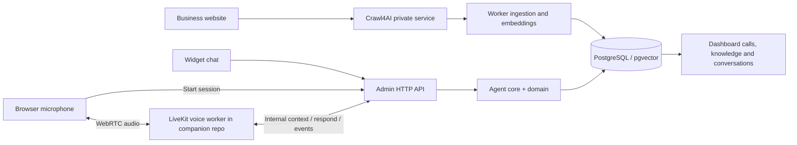

# Developer handoff: LobbyStack backend and Suncrest receptionist

Prepared 15 November 2026. This is the entry point for the incoming development team for **this fork and its Suncrest deployment**. Source paths below are relative to this repository. Provider state can change; the deployment table is a dated readback, not configuration to apply blindly.

## 1. Start here: two repositories, several runtimes

| Repository | Responsibility | Working branch |
| --- | --- | --- |
| [cecvic-wigoh/lobbystack](https://github.com/cecvic-wigoh/lobbystack/tree/codex/suncrest-v2) (this repo) | Suncrest dashboard/onboarding, knowledge ingestion, PostgreSQL, shared agent logic, chat API and LiveKit bridge | `codex/suncrest-v2` |
| [cecvic-wigoh/ai-receptionist-control-plane](https://github.com/cecvic-wigoh/ai-receptionist-control-plane/tree/codex/suncrest-v2) | LiveKit audio worker; also a separate older managed control plane and marketing frontend | `codex/suncrest-v2` |

Read the companion [voice/application handoff](https://github.com/cecvic-wigoh/ai-receptionist-control-plane/blob/codex/suncrest-v2/docs/DEVELOPER-HANDOFF.md). Clone both branches. `main` is **not** the checkpoint branch being handed over.

The Suncrest browser uses `VOICE_PROVIDER=livekit`. The active voice worker is **in the companion repository**, not `apps/worker` here. This repo also supports upstream GPT-Live/SIP sessions in `apps/worker`; [voice/runtime.md](voice/runtime.md) describes that separate path. Likewise, the older Fastify/Mastra/Vapi crawler in the companion repo does not feed this deployment. Historical production-cutover documents and `.railway/railway.ts` describe other environments; applying their infrastructure definitions to the Suncrest project would be the wrong operation.

## 2. Application map

| Location | What to change here |
| --- | --- |
| `apps/admin/app/` | Next.js App Router pages, API handlers, embed iframe, prospect demos, auth and dashboard routes |
| `apps/admin/src/components/`, `src/lib/` | UI, authenticated access, domain contexts, provider/session helpers; note that routes live in `app/`, not `src/app/` |
| `apps/worker/src/index.ts`, `outboxDispatcher.ts`, `handlers.ts` | Long-running worker, transactional outbox to BullMQ, retries and job handlers; upstream live-call attachment |
| `apps/landing/` | Astro marketing site, separate from the companion Trend Hubs frontend |
| `packages/domain/src/` | Shared business rules, catalogue parsers and requirements interpretation |
| `packages/domain/src/server/` | Tenant-authorized persistence, snapshots, knowledge lifecycle/search, bookings, contacts and call lifecycle |
| `packages/agent-core/src/` | Grounded answers, agent tools, instructions and model selection shared across channels |
| `packages/db/src/`, `packages/db/migrations/` | Drizzle schema, role-specific connections, RLS transactions, outbox and migration journal |
| `packages/providers/src/` | Crawl4AI/Firecrawl, embeddings, calendars, Twilio, email, encryption and object storage adapters |
| `packages/contracts/`, `jobs/`, `config/`, `shared/`, `telemetry/`, `ai/` | Validated contracts/jobs, runtime configuration, shared types, observability and prompt builders |
| `packages/embed/` | Vite widget loader; copied into admin public assets by the build script |
| `scripts/`, `docker/`, `Dockerfile.*` | Operators' checks, migration/recovery tools and image builds |
| `integrations/zapier/`, `mintlify/` | Standalone Zapier npm integration and documentation site; separate tooling from the app workspace |

Keep durable rules in domain, provider HTTP code in providers, and tool orchestration in agent core. Consult `AGENTS.md` and any nested guidelines before implementation. UI supports en/fr/es/sr-Latn; receptionist runtime languages are English/French, not all dashboard languages.

## 3. End-to-end flows



### Business setup and chat

1. An operator signs in through the admin authentication layer and creates/configures a business, agent, hours, services, languages, channel/widget and knowledge sources. Plan/booking/transfer capabilities come from stored configuration and the business snapshot, not caller instructions.
2. Knowledge upload/import creates durable records and enqueues outbox work. The async worker indexes the content, then refreshes the business snapshot.
3. The widget loader embeds `/embed/[key]`. Widget session/origin/key checks authorize the visitor; `apps/admin/app/api/widget/chat/route.ts` loads business context and conversation history, invokes `answerGroundedQuestion`, streams the result and persists the conversation. Visitors are identified by the widget visitor ID without requiring a phone number.
4. Dashboard views read persisted conversations/calls/knowledge. A visible chat answer alone is not proof of voice playback or transcript correctness.

### Browser voice

1. `apps/admin/app/api/voice/livekit/session/route.ts` authorizes the dashboard/widget/demo caller, checks allowed origins/rate limits/entitlement, records a call, and dispatches the named LiveKit agent. Inspect this handler and its end-session route for token and room cleanup rules.
2. The browser receives a scoped participant token and joins a LiveKit room. Dispatch metadata binds `backend=lobbystack`, `tenantId`, `callId`, direction and maximum duration. In this bridge `tenantId` is the LobbyStack **business ID**.
3. The companion worker's `src/main.ts` selects `LobbyStackClient`, fetches `/api/internal/livekit/context` and constructs the voice session. The worker owns audio, turn detection, synthesis, interruptions and spoken readout.
4. `askReceptionist` delegates business questions to `/api/internal/livekit/respond`. The handler is `apps/admin/app/api/internal/livekit/[operation]/route.ts`; it verifies the service bearer token, provider, business/call ownership and call state. It passes saved history to the shared grounded-answer function.
5. Verified factual text is spoken through the worker's explicit TTS readout. The voice model must not improvise a different fee, requirement, phone number or course list. Caller interruptions remain enabled.
6. `/api/internal/livekit/events` saves sequenced caller/assistant turns and media/completion state. Finalization records duration and closes both the call and any transfer rooms. Interrupted turns are reconciled with played audio by the voice worker, not the complete unplayed answer.
7. Transfers/messages are separately permissioned operations. A transfer needs the configured business policy/verified destination and `LIVEKIT_SIP_OUTBOUND_TRUNK_ID`; the staff acceptance flow has its own code and tests. A captured message needs confirmed caller details and permission. Neither feature should be inferred from a successful knowledge answer.

### Knowledge ingestion and retrieval

1. Domain knowledge functions in `packages/domain/src/server/knowledge.ts` normalize public URLs, create source/revision records and schedule `knowledge.crawlWebsite`. The worker checks cancellation/revision guards before accepting results.
2. `apps/worker/src/crawler.ts` selects Crawl4AI when configured; missing Crawl4AI authentication fails configuration instead of silently incurring paid crawls. When Crawl4AI is unset, the existing Firecrawl configuration is used. This is a selection fallback, not an instruction to fall back to paid crawling after every Crawl4AI runtime error.
3. `packages/providers/src/crawling/crawl4ai.ts` submits authenticated async crawl jobs. Discovery is bounded by same-site/public-URL rules, robots, depth, page budget and timeout. Navigation discovery does not guarantee sitemap-only or external-linked pages are imported.
4. Document extraction, including PDF/OCR handling, lives in `apps/worker/src/documentExtraction.ts`. Text is chunked, source-linked and embedded. Knowledge documents/chunks and embedding fingerprints are stored in PostgreSQL; objects use the configured storage provider. Generated Tesseract language caches are local artifacts, not application source.
5. `searchKnowledgeEvidence` in domain combines keyword/vector retrieval, reciprocal rank fusion and current evidence/revision checks. Keep business scoping and source attribution intact. Changing embedding model/dimensions requires a deliberate reindex; do not mix incompatible fingerprints.
6. `packages/agent-core/src/groundedAnswer.ts` routes named-program/requirements/fee facts, catalogue discovery and general grounded answers. Conservative unsupported/out-of-scope outcomes are intentional. Fix ingestion/retrieval evidence before weakening verification.
7. Catalogue discovery is structured: `courseCatalogue.ts` parses active indexed `/programs/`, `/courses/` and eligible training-product pages; its server loader checks source membership/revisions and bounds a business-scoped cache. Lists page five entries for voice/eight for chat. Categories come from published links and curriculum membership. Explicit more/next advances; a new broad “other interesting courses” question resets. Ordinal references resolve a listed title and pin detail retrieval to its URL. Unknown taxonomy membership stays in all areas. The resolver is shared by grounded answers and the older agent tool path, not hardcoded to Suncrest's name.

No crawl occurs while a caller waits for an answer. No LlamaIndex or replacement vector database is required for this implemented path. Crawl4AI is open source; hosting, embeddings and model/audio use still have costs.

## 4. Data ownership and authorization

PostgreSQL is canonical. Key records include businesses/memberships, agent/context snapshots, knowledge documents/chunks, conversations/messages, calls/transcripts, contacts, appointments, outbox/jobs, notifications and usage records. Use `packages/db/src/schema/index.ts` and domain exports for exact fields rather than guessing schema names.

Use role-specific connections (`lobbystack_app`, `auth`, `worker`, `dispatcher`, `readonly`; migrations use the migrator/admin connection). `withBusinessTransaction` sets transaction-local business/user/actor context for forced RLS. An actor label is not a replacement for database role or authorization. Never bypass RLS with a production administrator connection to make a tenant query work. Cross-business platform administration must use its existing privileged authorization path.

Redis is queue/rate-limit/realtime infrastructure; retain outbox durability and deduplication. Object storage is part of backup/retention, not disposable cache. Protect webhook signatures, encrypted provider credentials, widget/session signing secrets and the internal bearer token. Source website text is untrusted reference material, never an instruction to the app.

## 5. Fresh local setup

Use Node >=22.12 (CI uses 22.12.0), pnpm **10.30.3**, Docker and separate development provider accounts. The companion voice repo uses a different Node/pnpm version.

```sh
git clone --branch codex/suncrest-v2 https://github.com/cecvic-wigoh/lobbystack.git suncrest-lobbystack
cd suncrest-lobbystack
pnpm install --frozen-lockfile
pnpm --filter @lobbystack/worker... build
pnpm env:generate
```

`env:generate` creates `.env` with local secrets and refuses to overwrite an existing file by default. Before continuing, add `DATABASE_URL=postgres://postgres:<generated POSTGRES_PASSWORD>@127.0.0.1:15433/lobbystack` and `REDIS_URL=redis://127.0.0.1:16380` to that local file, adapting ports if changed. These connection URLs must be supplied explicitly; the example lists port/password fields but does not construct host-process URLs for you. Keep `APP_BASE_URL` consistent with `ADMIN_PORT` (the current example uses `http://localhost:13000`). For local file uploads, `STORAGE_PROVIDER=local` is available; configure S3/MinIO separately if exercising it.

```sh
docker compose up -d postgres redis
pnpm db:migrate
pnpm db:check
pnpm db:verify-rls
pnpm dev
```

Fresh Docker volumes run `docker/postgres/init/roles.sh` with the generated role passwords. Changing passwords in `.env` does not update an already-initialized volume. Preserve existing volumes and update credentials deliberately rather than deleting customer data. Migration CLI loads root `.env.local`/`.env`; verify database host/database first. Migration and restore commands are mutating, not generic smoke probes.

Add valid text/embedding provider keys to test factual answers; mocked unit tests do not need live keys. For browser voice set admin `VOICE_PROVIDER=livekit`, development LiveKit credentials and an agent name that matches the companion development worker. A cloud worker needs a reachable HTTPS backend; `localhost` on the cloud worker is not your laptop. Use a separate LiveKit project/agent name so development does not consume production dispatches. Public signup also needs a real Turnstile configuration for its hostname; do not disable that protection to make production signup pass.

Crawler setup: follow [deployment/crawl4ai-knowledge.md](deployment/crawl4ai-knowledge.md). Its Docker build context is `docker/crawl4ai`, not the whole repository. Configure the worker URL/token and the crawler token together. Keep the service authenticated and private; public URL/egress protections remain enabled.

## 6. Configuration and access handover

Obtain credentials via the team's approved password manager/provider access process, not Git or Markdown. The current `.env.example` and `packages/config` are the variable-name references.

| Group | Used by | Relationship |
| --- | --- | --- |
| PostgreSQL role URLs/passwords | admin, worker, migrator | Same host/database, least-privilege role credentials; role passwords can derive URLs from `DATABASE_URL` |
| `REDIS_URL`, `REDIS_PREFIX` | admin, worker | Environment-specific queue/cache namespace |
| Auth/session/encryption/OTP secrets | admin and relevant workers | Preserve established values; ad hoc rotation can invalidate sessions or encrypted provider data |
| `INTERNAL_SERVICE_TOKEN` | admin/worker, companion bridge | Equals companion `LOBBYSTACK_SERVICE_TOKEN` |
| `VOICE_PROVIDER`, `LIVEKIT_*` | admin; companion voice worker | Provider must be `livekit` for the Suncrest bridge; credentials/project/agent name must agree |
| `OPENAI_API_KEY`, `AI_CHAT_*`, `AI_EMBEDDING_*` | answer/indexing runtimes | Explicit embedding credentials can override the general key; check model/fingerprint before reindexing |
| `CRAWL4AI_BASE_URL`, `CRAWL4AI_API_TOKEN` | indexing worker | Private URL and shared crawler token; Firecrawl is the alternate configuration |
| Storage variables | admin, worker | Persistent local or S3-compatible objects; Railway production uses its configured bucket |
| Twilio/trunk/calendar/email/billing keys | owning providers/services | Only enable corresponding product flow once that provider/account configuration is verified |
| `SERVICE_VERSION`, OTLP settings | services | Release traceability; telemetry failure should not make readiness fail |

Incoming team needs access to both GitHub repos (the voice repo is private; this fork is public), Railway Suncrest project/environment/services/bucket/backups, the LiveKit project/agent and any SIP trunk, model/embedding providers, Twilio, sending domain/email provider, DNS/Turnstile, configured calendar and billing providers. Access is a handover prerequisite, not granted by this document. Assign owners for billing, incidents and backups; do not reuse a previous developer's personal credentials indefinitely.

## 7. Deployment and rollback

Readback on 15 November: Railway project `61fb9bb1-2ca6-4333-8c78-eafaf439f43a`, production; public admin `https://admin-production-ad1d.up.railway.app`. Browser demo: `/en/demo/suncrest`. Suncrest business ID: `9598f317-838d-4126-804c-cb8b376ac0e2` (operational locator, not authorization).

| Service | Latest readback | State |
| --- | --- | --- |
| admin | `999121a9-0f25-4993-a985-7aa42efa8736` | SUCCESS; deployed 10 November |
| worker | `bc779691-60f4-416e-9a16-e586c9a5b174` | SUCCESS; deployed 10 November |
| private Crawl4AI | `70b3223d-f91c-4999-89d5-7df87bffaaa0` | SUCCESS; deployed 6 November |
| companion LiveKit agent `CA_QYUz6BvyPBiS` | `gcWEGTtmsk6m` | Running; deployed 9 November |

These releases were CLI uploads of working source. They are not proof that the GitHub default branch matches production, nor that pushing a branch deploys it. Capture both repo SHAs and deployment IDs for every future release; verify configured GitHub auto-deploy sources before pushing/releasing.

For a deliberate backend release, link the CLI to the exact Suncrest project and **production** environment, review changes, run checks, run the separate migrator only if a reviewed migration is required, then deploy the worker/admin from the repository root with their respective Dockerfiles. Existing commands are `railway up --service worker` and `railway up --service admin`; a detached upload is only started, not verified. If changing the crawler image, deploy it separately from its directory. For a voice release, use the companion repo's `lk agent deploy apps/voice-worker` and pinned patches.

Wait for the exact new deployment IDs to reach SUCCESS/Running. Check `/api/health/live` and `/api/health/ready`; readiness covers database/storage, not answer quality. Repeat actual browser/API/audio/transcript acceptance below. Public build-time `NEXT_PUBLIC_*` settings require a rebuild. Preserve secrets and client records through rollout. Avoid removing old serving instances while active calls are using them.

Rollback admin and worker to a known compatible previous Railway release, and the LiveKit agent separately if needed. Keep a paired release record. Code rollback does not undo a destructive migration, restore objects or reroute phone numbers. Follow [operations/backup-restore.md](operations/backup-restore.md) for database **and object** recovery; perform restore drills on disposable stacks. [deployment/railway.md](deployment/railway.md) and `.railway/` cover the upstream environment—review ownership before applying any IaC.

Crawler rollback: unset worker Crawl4AI URL/token and redeploy with verified Firecrawl configuration; stored index remains. Re-crawling is a separate action. Keep replacement-import/reconciliation tooling and legacy lineage columns until their rollback windows have explicitly closed.

## 8. Verification and acceptance

```sh
pnpm typecheck
pnpm test
pnpm build
pnpm test:build-config
# Dedicated local test database only; see CI's database job for role URLs:
pnpm db:check
pnpm db:verify-rls
```

`pnpm test` can skip database integration suites without dedicated test URLs. See `.github/workflows/ci.yml` and `pnpm test:reliability`; never substitute production URLs for destructive test databases. Admin Playwright tests have separate configuration and seeding. The build verifies/copies embed assets; review generated loader changes. The backend CI runs code checks on PRs/main, not arbitrary branch pushes, and does not itself certify a live phone conversation.

Minimum release acceptance:

1. Authenticate as a normal tenant and platform administrator; check business boundaries and a second tenant's isolation.
2. Import a small controlled public page through the actual outbox/worker; verify current indexed revision, embeddings and source URLs before a bounded full crawl. Preserve manual/disabled/quarantined documents. Report discovered/imported/failed/skipped counts rather than “entire website” without evidence.
3. In the Suncrest browser chat ask exactly “Okay, what other interesting courses are there that I can study at Suncrest?” and “Can you tell me the list of courses that Suncrest offers?”; expect a sourced first page, not unsupported refusal.
4. Ask categories → Business → show more; ensure category retained, page advances without repeated sources. Test programs-only vs individual courses, “requirements for the first one,” then the original broad question to reset. Include voice-expanded wording such as “What categories of courses does Suncrest offer? Business courses. Show more.”
5. Start a real browser/WebRTC voice call, ask the same questions, interrupt a longer answer, request a formatted contact number, and hang up. Independently listen/transcribe the received audio; compare saved final turns, played portion and canonical number. SDK captions alone are insufficient.
6. Verify call completion, duration/billing rules, transcript sequence and room cleanup. Synthetic QA calls use existing internal-QA/billing-excluded mechanisms. Do not create staff notifications, real bookings or messages during a read-only answer test.
7. Certify PSTN, staff transfer acceptance/failure and actual calendar changes separately with controlled destinations before claiming those flows work. Browser success does not certify telephone routing.

Last detailed live catalogue acceptance (10 November): 15 API cases, two recorded billing-excluded WebRTC calls and browser exact-question/category/ordinal replays. Index then contained 1,311 **entries** (99 program pages, 1,163 curriculum course pages, 49 training products), with 14 category labels. Counts are neither distinct open enrolments nor a current inventory claim. See [validation/suncrest-catalogue-2026-11-09/README.md](validation/suncrest-catalogue-2026-11-09/README.md), its `acceptance.json`, screenshots, transcripts and audio. Earlier reliability/voice/latency evidence is under adjacent dated validation directories. Fresh handoff checks are recorded in [handoff/verification-2026-11-15.md](handoff/verification-2026-11-15.md).

## 9. Troubleshooting and remaining work

| Symptom | Inspect first |
| --- | --- |
| Knowledge refuses known website fact | Active source/revision and readable extraction, embedding model/fingerprint, hybrid evidence, then grounded-answer outcome/logs. Do not edit the unrelated legacy crawler. |
| Category menu repeats / paging sticks | Actual tool question plus last persisted assistant header; preserve the combined-query and broad-reset regressions in `courseCatalogue.test.ts`. |
| Wrong requirements for similar programmes | Listed source URL must pin program selection and detail retrieval; inspect `courseRequirements.ts`, `programCatalog.ts` and exact source text. |
| Voice preamble/dead air or duplicate answers | Companion tool completion, preamble cancellation, model vs TTS timing, streaming plugin patch and `voice_turn_timing`/`voice_tts_timing`; distinguish first audio from full response length. |
| Interrupted transcript contains unheard words | Companion patched SDK, outgoing played PCM boundary and played-only ASR. Whole generated answer is not the transcript. |
| Spoken phone number changes | Canonical sourced number and `phone-readout.ts` pronunciation transform; test actual audio, not just displayed digits. |
| Ingestion queued forever / empty import | Outbox/BullMQ worker, private crawler token/health/job status, embedding key, extraction errors and revision/cancellation guards. |
| Signup/email fails | Turnstile site/server keys and build hostname, auth domain/cookies, worker outbox and Resend/sending-domain delivery; a queued email is not inbox receipt. |
| 401/404/410 on bridge | Service-token equality, provider setting, call/business/provider binding and ended state. Do not relax authorization. |
| Transfer unavailable | Business policy/destination, trunk, staff screening/press-one acceptance and message fallback; preserve false-success protections. |

Known boundaries: call-quality review has schema/domain foundations but **no released dashboard/API**; see [validation/call-quality-review-foundation-2026-11-03.md](validation/call-quality-review-foundation-2026-11-03.md). Its recorded migration status is historical and must be checked before production migration. Self-service onboarding, billing/payment provider readiness, CRM ambitions, all-tenant answer accuracy, PSTN and human transfers are not certified by the Suncrest catalogue release. Some behavior is source-shaped (known course paths and explicit category links); a different catalogue needs evaluated parser support, not invented taxonomy. Historical architecture/compliance claims are design records, not an attestation of present residency/compliance or product completeness.

First incoming-team milestone: reproduce local checks, confirm provider access, run one end-to-end Suncrest session, establish a paired release/rollback record, and prioritize the unverified product flows with observed failures and acceptance evidence.
